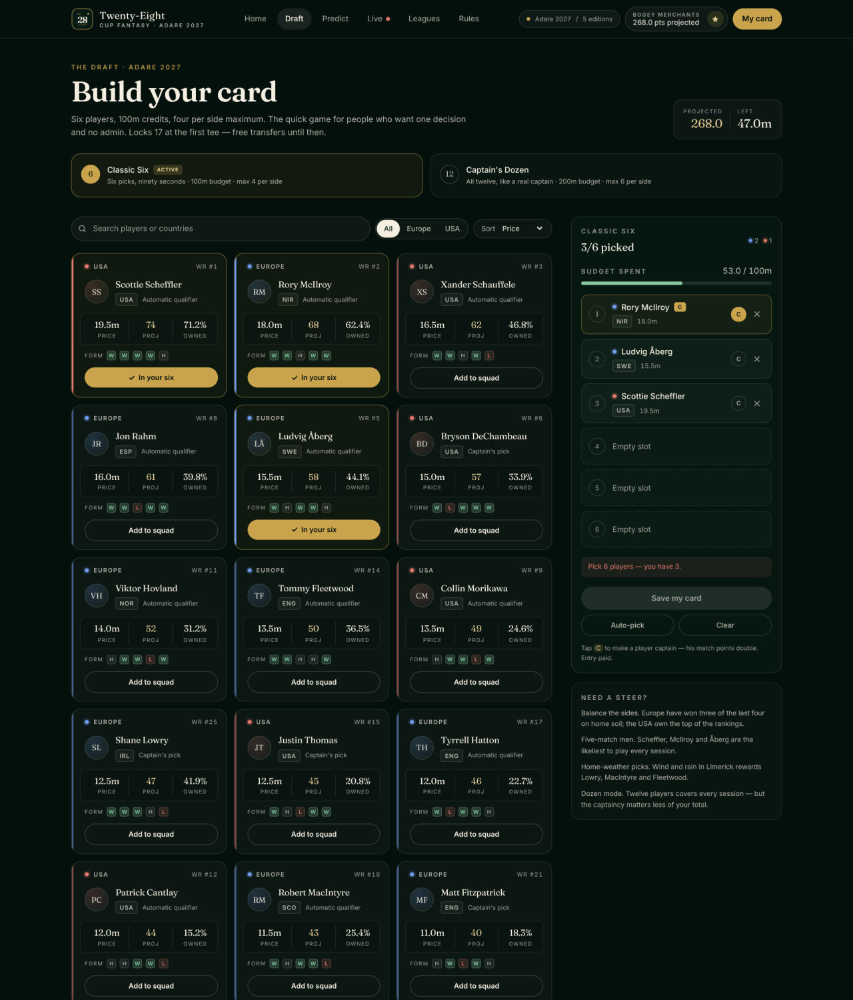
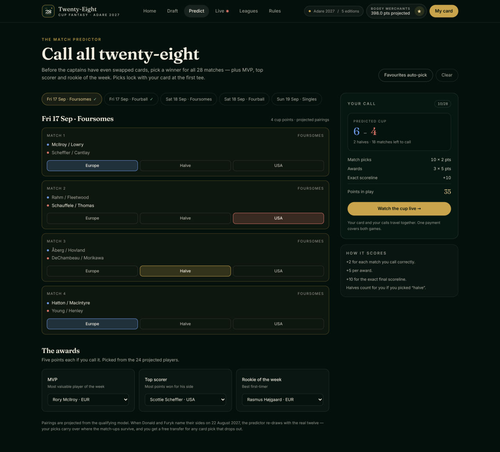
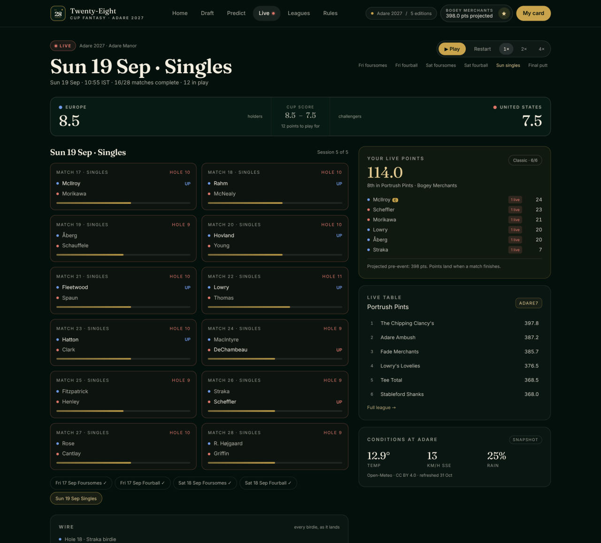

# spring-android-rest-demo

Two things live in this repository.

## 1. Twenty-Eight — fantasy for the Ryder Cup (`adare-fantasy/`)

A fantasy platform for the Ryder Cup: one brand and one scoring engine, a new
*edition* for every cup. The first is **Adare 2027** — Adare Manor, Co. Limerick,
17–19 September 2027. Draft a card, call all 28 matches, follow the cup live,
in a paid entry with a private league and a prize ledger.

**[▶ Try it](#try-it)** · [Screenshots](adare-fantasy/docs) · [What it does](adare-fantasy/README.md) · [Install](adare-fantasy/INSTALL.md) · [Deploy](adare-fantasy/DEPLOY.md)

| Draft a card | Call all 28 matches | Follow it live |
|---|---|---|
|  |  |  |

### Try it

| Route | What you get | How |
|---|---|---|
| **A Codespace** | the whole app, live, in about four minutes | [**Open in a Codespace →**](https://codespaces.new/pronane/spring-android-rest-demo?quickstart=1) — it installs, migrates, seeds and starts itself; the Ports tab gives you the public URL |
| **A permanent deployment** | `https://your-project.vercel.app` | [adare-fantasy/GO-LIVE.md](adare-fantasy/GO-LIVE.md) — Vercel + Turso or Neon, both free, no card |
| **A gallery on GitHub Pages** | screenshots and a frozen leaderboard | enable **Settings → Pages → Source: GitHub Actions**, then run the *Twenty-Eight static gallery* workflow |
| **Your own machine** | `http://localhost:3000` | `cd adare-fantasy && ./install.sh && ./start.sh` |

Checkout is a demo: no card is charged and no card data is stored. Sign-in works
with one-time email links (a local inbox by default) and, once you add
credentials, with Google, Apple and Facebook.

> Independent fan project. Not affiliated with the Ryder Cup, DP World Tour, PGA
> of America or Adare Manor.

## 2. The Spring Android REST demo (`app/`)

The original demo this repository was created for: a small Android app talking to
a Spring Boot REST service. It is still here, untouched, and unrelated to
`adare-fantasy/` — build it with `./gradlew`.
