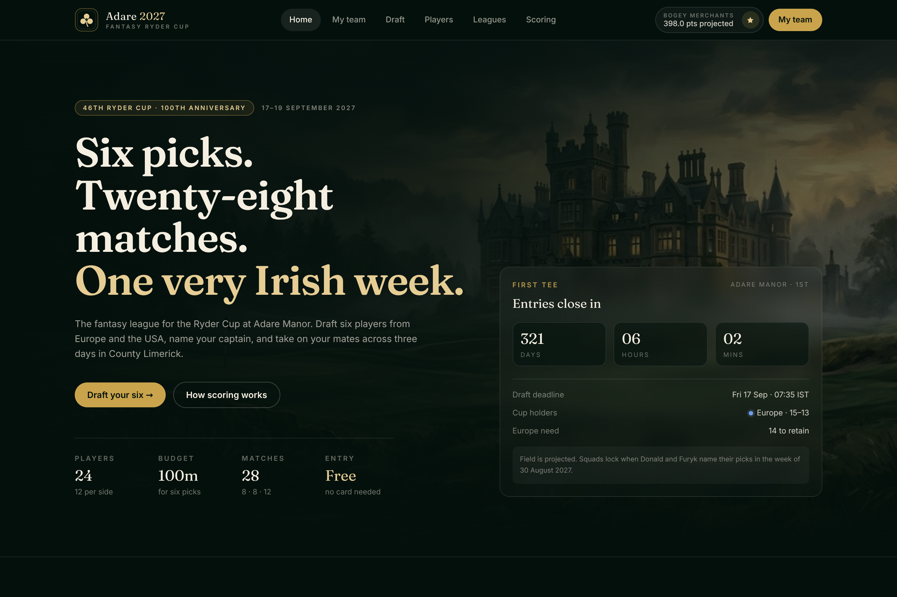

# Adare 2027 — Fantasy Ryder Cup · v0.1

A working first draft of a fantasy league for the **46th Ryder Cup at Adare Manor, Co. Limerick
(17–19 September 2027)** — the 100th anniversary of the matches and Ireland's first staging since
the K Club in 2006.

Pick six players, one from each side minimum and four maximum, inside a 100m budget. Name a
captain whose match points double. Score across 28 matches. Beat your mates in a private league
with a six-character code.

---

## The product in one screen

| | |
|---|---|
|  | The pitch: venue art, live countdown to the first tee, the three-step game loop, your card, the open table and the field. |

More screens: [`screenshots/`](screenshots) — draft room, team sheet, leagues, player pool,
scoring rules, plus mobile captures.

| Screen | File |
|---|---|
| Landing page (hero) | `screenshots/00-home-hero-desktop.png` |
| Landing page (full) | `screenshots/01-home-desktop.png` |
| Draft room (`/draft`) | `screenshots/02-draft-desktop.png` |
| My team (`/team`) | `screenshots/03-my-team-desktop.png` |
| Mini-leagues (`/leagues`) | `screenshots/04-leagues-desktop.png` |
| Player pool (`/players`) | `screenshots/05-players-desktop.png` |
| Scoring & rules (`/rules`) | `screenshots/06-scoring-desktop.png` |
| Mobile: landing / draft / team | `screenshots/07-…`, `08-…`, `09-…` |
| Mobile storyboard (all three) | `screenshots/10-mobile-storyboard.png` |

---

## The game rules (as drafted)

**Squad** — 6 players, 100m credits, max 4 from either side, at least 1 from each. Field of 24
projected players (12 Europe, 12 USA) priced by projected output.

**Scoring** — every match your player appears in:

| Session | Win | Half | Loss |
|---|---|---|---|
| Foursomes (Fri & Sat) | +5 | +2.5 | 0 |
| Fourball (Fri & Sat) | +5 | +2.5 | 0 |
| Singles (Sun) | +6 | +3 | 0 |

Bonuses: appearance +1, birdie +1, eagle +4, albatross +8, hole-in-one +10, unbeaten week (3+
matches) +5. **Captain: match points ×2** (bonuses unaffected).

**Admin** — 2 free transfers before the lock (Fri 17 Sep 2027, 07:35 IST), then −4 points each.
Armband can be moved freely before the lock, and once between sessions.

**Leagues** — open global table plus private leagues joined with a code (demo code `ADARE7`).
Commissioner creates a league, shares the code, table sorts live.

---

## Stack and why

| Choice | Reason |
|---|---|
| **TypeScript + Next.js 15 (App Router)** | One language for UI and the scoring API we will need next (route handlers for live points, cron for data ingestion). Server rendering gives real shareable URLs and link previews for league invites — important because the growth loop is "join my league" links in WhatsApp. |
| **Tailwind CSS v4** | Fast iteration on a bespoke design system (forest/cream/gold palette, Fraunces + Inter, self-hosted `.woff2`) with no runtime CSS-in-JS cost. |
| **React context + `localStorage` for state** | v0.1 needs to be clickable end-to-end without auth or a database. The store (`lib/store.tsx`) is deliberately the only place that knows persistence — swapping in an API + Postgres later is a contained change. |
| **Pure helpers in `lib/helpers.ts`** | Budget, validation, projections and auto-pick are framework-free and unit-testable; server components can call them too. |

Considered and rejected for v0.1: **Vite + React** (no server-side surface for scoring/webhooks),
**native iOS/Android** (install friction for a three-day event — a responsive web app is the right
shape, PWA later), **Firebase** (fast but harder to model the scoring pipeline and audit trail).

---

## Running it

```bash
cd adare-fantasy
npm install
npm run dev      # http://localhost:3000
npm run build    # production build
npm run typecheck
```

Deploy: `vercel --prod` (or any Node host). No environment variables are required in v0.1.

### Project structure

```
adare-fantasy/
├─ app/                 # routes: /, /draft, /team, /players, /leagues, /rules
├─ components/          # header/footer, player tiles, squad board, league table, countdown
├─ lib/
│  ├─ data.ts           # tournament facts, 24-player field, leagues, leaderboard seeds
│  ├─ helpers.ts        # budget, validation, projections, optimal auto-pick (brute force)
│  └─ store.tsx         # client state + localStorage persistence
├─ public/              # hero art, self-hosted fonts
└─ screenshots/         # the captures in this doc
```

The demo card ("Bogey Merchants", squad of six, two leagues) is pre-loaded so every screen has
content on first visit. "Start fresh" clears it; "Load the demo card" brings it back.

---

## What is real vs. mocked (important)

**Real:** the venue, dates, format, current captains (Luke Donald / Jim Furyk), the 100th
anniversary framing, the countdown deadline, all interaction (drafting, validation, captain,
leagues, codes, persistence).

**Mocked for the draft:**
- The 24-player field, prices, projections, ownership %, form and records are **synthetic
  projections** — the real field is named in August 2027 (six automatic qualifiers per side on 22
  Aug, captain's picks the week of 30 Aug).
- League tables and the global leaderboard are seeded; "projected points" stand in for live scoring.
- No accounts, no database, no payments. Each browser has its own card.

---

## Roadmap to v1

1. **Real data.** Ingest the European points list and US qualifying standings + OWGR on a nightly
   job; reprice players automatically; "field confirmed" flow that refunds missing players.
2. **Accounts & persistence.** Email magic-link auth, Postgres + Prisma, server-side squads and
   leagues, invite links with preview cards.
3. **Live scoring.** Hole-by-hole feed, idempotent match scoring, recalculation after each session,
   league tables pushed over websockets with a manual override console for corrections.
4. **Game depth.** Armband switch windows, transfer market at the lock, "head-to-head" mode for
   private leagues, per-session captaincy.
5. **Notifications.** Email/WhatsApp nudges before the lock and a Sunday-evening results digest.
6. **Growth & polish.** PWA install, shareable team cards (OG images), Irish-language toggle,
   accessibility pass, sponsor/prize slots for private leagues.
7. **Legacy mode.** Replay Rome 2023 and Bethpage 2025 with historical scoring between cups.

## Open questions for you

- **Name and brand.** "Adare 2027" is a working title. Something more ownable for future cups
  (a platform that re-skins per venue) may be better: the app is already structured around a
  `TOURNAMENT` object, so 2029/2031 are a data change, not a rewrite.
- **Scoring weights.** Birdies/eagles reward aggressive players; should halves be worth 2 or 3?
  Captain ×2 on match points only, or on the whole card?
- **Squad size.** Six keeps it fast; eight or a full 12-player "captain" mode is more authentic but
  three times the admin.
- **Free vs. paid.** Free keeps the group-chat loop; a paid tier needs prizes and T&Cs.
- **Data licensing.** Official scoring feeds are licensed — budget for it before v1.

---

## Screenshot method

Captured with headless Chromium (Puppeteer) at 1440×1000 (desktop, 1.5× DPR) and 390×844 (mobile,
2× DPR), with the demo card pre-seeded into `localStorage` so the states are reproducible.
