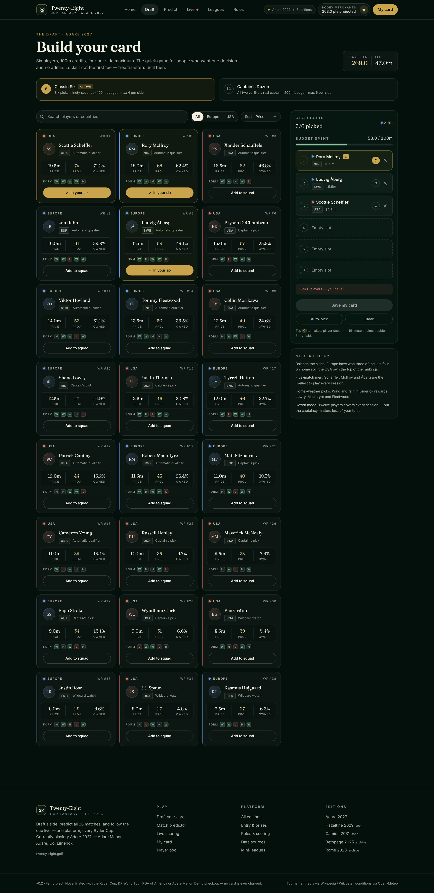
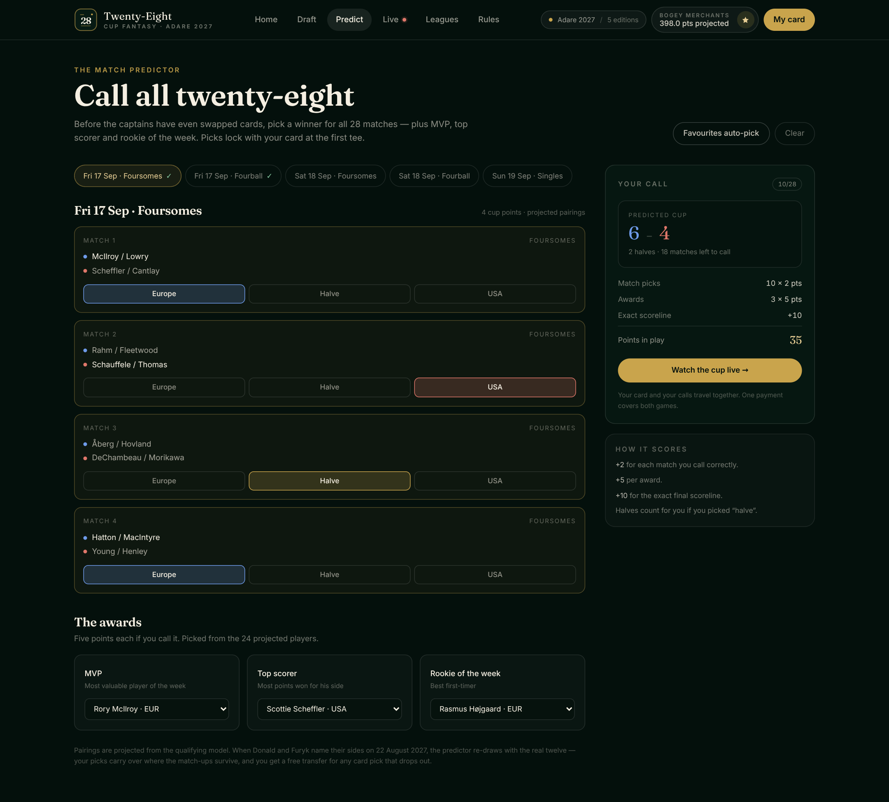
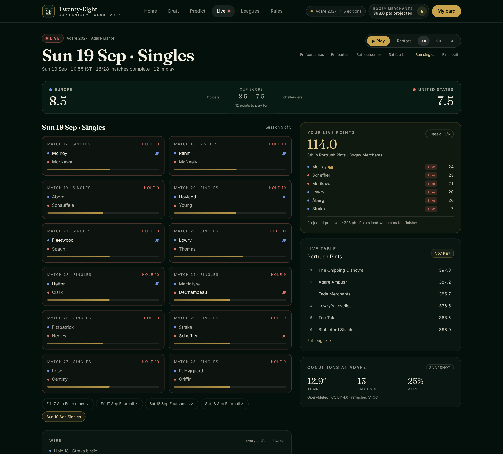
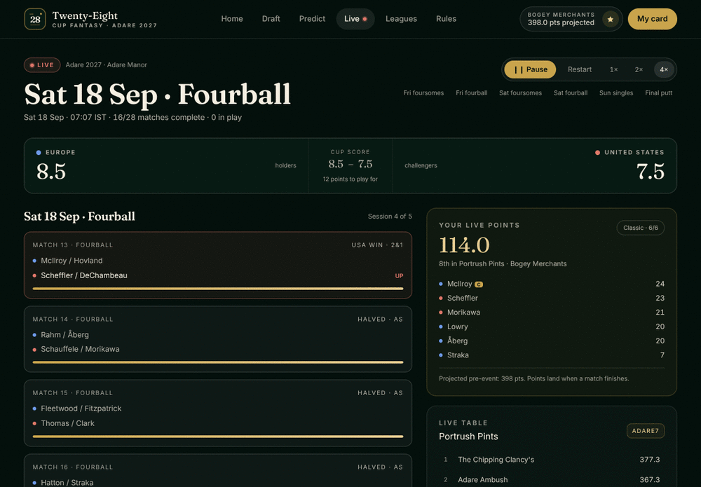

# Twenty-Eight — fantasy for the Ryder Cup · v0.9

**Twenty-Eight** is a platform for Ryder Cup fantasy games: one brand, one scoring engine, and a
new *edition* for every cup. The first live edition is **Adare 2027** — the 46th Ryder Cup at Adare
Manor, Co. Limerick (17–19 September 2027), the 100th anniversary of the matches and Ireland's
first staging since the K Club in 2006.

Two ways to play, one paid entry, a 28-match predictor, and a live Sunday you can watch tick over.

| Draft a card | Call all 28 matches | Follow it live |
|---|---|---|
|  |  |  |

▶ **[Watch the 2:48 start-to-finish demo](demo/twenty-eight-start-to-finish.webm)** — a paid entry, a
drafted card, 28 predictions, a private league, a decided cup and the prize pot settled, recorded from
this build ([what happens, minute by minute](demo/README.md)).

> v0.2 is a fan project. Not affiliated with the Ryder Cup, DP World Tour, PGA of America or Adare
> Manor. Checkout is a demo — no card is ever charged and no card data is stored.

---

## What changed in v0.2

| v0.1 | v0.2 |
|---|---|
| Working title "Adare 2027" | **Twenty-Eight** — ownable platform brand, `28` monogram, edition-aware masthead |
| One game (Classic Six) | **Classic Six** *and* **Captain's Dozen** (12 players, 200m, max 6 a side) |
| Free, no entry | **Paid entry** (€10 / €60 league pack / €24 season pass), prize pool + sponsor slots |
| Standings that were "projected" | **Live scoring simulation** across all five sessions, with a wire |
| Draft only | **Match predictor** — all 28 matches, plus MVP / top scorer / rookie |
| Adare only | **Editions** — Adare 2027, Hazeltine 2029, Camiral 2031, plus the Bethpage 2025 and Rome 2023 archive |
| Static demo data | **Free data layer** — Wikipedia, Wikidata and Open-Meteo snapshots refreshed by script |
| Client-only state | **Session auth + server store** for entries, with cookies and HMAC signing |

- Landing: `/` · Draft: `/draft` · Predictor: `/predict` · Pinpoint: `/pinpoint` · Live: `/live` · Table: `/leaderboard` · Entry: `/enter`
- Editions: `/editions` · Leagues: `/leagues` · My card: `/team` · Account: `/account`
- Rules & scoring: `/rules` · Player pool: `/players`

Full screenshot set (14 desktop/mobile captures + a GIF of the live simulation) is in
[`screenshots/`](screenshots).

---

## What's new in v0.9

- **A public demo you can put up for free.** **[DEPLOY.md](DEPLOY.md)** is the ten-minute path to a
  real URL — Vercel Hobby for the app, Neon's free Postgres for the data — plus Render, GitHub
  Codespaces and a tunnel-from-your-laptop option, with the free-tier catches spelled out.
- **GitHub Pages, honestly labelled.** Pages cannot run this app (no Node, no sessions, no database),
  so [`docs/`](docs) is a static gallery instead: the screenshots, the feature list, and the
  leaderboard read from a real JSON export. Published by `.github/workflows/pages.yml`.
- **`npm run snapshot`** freezes a running instance into `docs/data/*.json`; **`npm run seed`** fills
  a hosted database with seven demo entries and a league, so a fresh deployment is not an empty table.
- **`/api/health`** reports how a deployment is actually configured — store, table count, whether the
  filesystem is ephemeral, payments mode, which social sign-ins are live — and the app warns at boot
  when a hosted build has no `DATABASE_URL` or `SESSION_SECRET` instead of quietly losing entries.

## What's new in v0.8

- **One command to run it on any machine.** `./install.sh` (macOS/Linux) or `.\install.ps1`
  (Windows) checks what is installed, downloads what is missing, sets up the database, writes
  `.env.local`, builds, and smoke-tests the result — without `sudo`, `UAC`, Docker or a system
  Postgres. Then `./start.sh` / `start.cmd` runs it. See **[INSTALL.md](INSTALL.md)**.
- **A real Postgres backend.** `DATABASE_URL` now selects the tables in [`db/schema.sql`](db/schema.sql)
  — users, identities, leagues, orders, the ledger, prizes, sign-in tokens, webhook ids and the
  operator's results override — with `npm run db:migrate` applying the schema (and any
  `db/migrations/*.sql` after it) and recording a checksum. Unset, the app still runs on the JSON
  file, so a clone needs no database at all. Both backends pass the same 93 API checks and the same
  15-step browser test.
- **Postgres without an installer.** The server binaries ship as npm packages
  (`@embedded-postgres/<platform>-<arch>`), so `npm run db:local -- start` creates a cluster inside
  `.data/pg` on 127.0.0.1:54329 — macOS arm64/x64, Linux x64/arm64, Windows x64. `db:local stop`,
  `status` and `reset` are the rest of it.
- **`npm run e2e` — a browser, a real entry, every page.** It buys an entry with the demo card,
  drafts six players by hand and names a captain, calls all 28 matches session by session, reads its
  own points, checks the fantasy table and the public card, makes a transfer, and signs out and back
  in through a one-time email link (the "email" lands in `.data/outbox`). 15 steps, ~40 s, headless by
  default, `--headed` to watch, `--shots` for a screenshot per step.
- **`npm run db:check`** builds a throwaway Postgres, applies `db/schema.sql`, and drives every
  store function — 27 assertions, no server of your own.

## What's new in v0.7

- **Sign in with Google, Apple or Facebook.** A player who entered with a card can come back on a
  new phone and tap one button instead of waiting for an email. The flow is the authorisation-code
  flow with **PKCE (S256)**, a signed single-use state cookie (`te_oauth`, 600 s) and a **nonce**
  echoed in the ID token; the token's signature is verified against the provider's JWKS before a
  single claim is believed.
- **One account, whichever door you came in by.** A provider identity is stored on the user
  (`User.identities`), so a verified email that already has an entry — bought by card or created by
  a magic link — *signs into that entry* rather than starting a second one, and the provider is
  linked to it. An identity already attached to another entry is refused rather than moved, and
  switching accounts from a signed-in browser is refused too: a paid entry is never silently
  swapped.
- **Nothing is enabled until you configure it.** `/api/auth/providers` lists only the providers with
  complete credentials, and `components/SocialSignIn.tsx` draws only what that endpoint returns — so
  a clone with no `.env.local` shows no social buttons at all, and the demo cannot be mistaken for a
  configured one. Fill in all of Google's, Apple's or Facebook's variables and that button appears.
- **Apple is done properly.** Apple has no static client secret: `appleClientSecret()` mints the
  ES256 JWT from `APPLE_TEAM_ID` / `APPLE_KEY_ID` / `APPLE_PRIVATE_KEY` (six months at most), the
  callback accepts Apple's `form_post` as well as a query string, and the name Apple posts once is
  used when the token carries none.
- **The rules are under test.** `npm run oauth:check` asserts **79** things — provider gating, PKCE,
  state signing/tampering/expiry, RSA and ES256 ID-token verification (audience, issuer, expiry,
  skew, nonce, `alg=none`), Apple's secret, and every branch of `signInWithIdentity` against a
  throwaway store. The API suite adds the provider endpoint, the start endpoint's failure mode and
  the open-redirect guard.

## What's new in v0.6

- **The server scores the weekend, not the browser.** `lib/server/clock.ts` is the one clock: a
  snapshot is the matches **finished at that minute**, so a mid-Sunday request scores the 24 matches
  in the books rather than guessing the last four. The table, a private league, the account
  breakdown, the share card and the API all read the same snapshot. `SCORING_CLOCK=live` follows
  real time from the first tee; `SCORING_CLOCK=at:1500` replays Saturday afternoon;
  `?at=1500` does it for a single request. A partial table is labelled **provisional**, with the
  session and the count of matches in play.
- **The feed is read on the server.** `lib/server/feed.ts` fetches `LIVE_FEED_URL` once per 20 s and
  overlays the provider's finals and events onto the simulation's pairings — so the same numbers
  reach a webhook, a cron job and a browser. `/api/live` uses the same reader, and a broken feed
  still falls back instead of emptying the page.
- **Transfers with a cost.** After the lock each entry has **two free changes** for the edition;
  after that each one is **−4 points**, taken off the total (the card itself is untouched, and the
  breakdown shows both). Swaps are only possible in the **windows between sessions** — before the
  first tee, Friday night, Saturday night — and are refused while a match is under way. Every rule
  is re-checked on the server (`lib/server/transfers.ts`), including the budget and the six-a-side
  cap, and every swap is recorded with its window and price.
- **The armband, day by day.** You can name a captain per day (Fri / Sat / Sun); that day's match
  points double, and leaving a day blank means nobody is doubled. The overall captain is still the
  fallback, so older cards keep scoring exactly as before, and the breakdown reports what the
  doubling was worth.
- **A card you can share.** Every entry has a public page at `/t/<entry ref>` — team, manager,
  points, rank, the six players and the cup — rendered on the server from the same snapshot, with
  an Open Graph image generated per entry (`/t/<ref>/opengraph-image`) and copy / WhatsApp / X
  buttons. It previews properly when someone shares it.
- **Invites that pay for themselves.** The invite code *is* the entry ref. Enter with `?ref=` and,
  once your order settles, both cards get one extra free transfer — idempotent, so a retried
  webhook cannot stack credits. The account page shows who joined on your link and what it earned.
- **Rules under test.** `scoring:check` grows to **55** assertions (per-day armband, penalties,
  windows, clock); the API suite adds 26 (transfers, armband, referrals, share page, `?at=` replays),
  the browser suite adds 11, and `verification/harness/clock.mjs` covers the overnight window and the
  −4 penalty against a server started with `SCORING_CLOCK=at:600` — 266 checks in all.

## What's new in v0.5

- **Payments are real.** `POST /api/checkout` no longer grants anything: it opens a **pending order**
  and returns a Stripe Checkout URL (or, without keys, the demo payment page). An entry is created only
  when the order settles — by Stripe webhook, or by the demo provider. Paying twice, refreshing, or a
  retried webhook all end with one entry.
- **A ledger, not a number.** Every settled payment writes three rows — cash in, the platform's 5%, the
  prize pool's 95% — and refunds reverse them, so "taken", "fees", "pool" and "paid out" always add up.
- **Prizes settle from the table.** `POST /api/admin/prizes` ranks the eligible field *inside its pot*
  (a league pot or the global one), applies the published split, and records who is owed what. Lines
  that cannot be awarded — no 2nd place, nobody outside the podium, no predictor points — are returned
  and shown, rather than quietly dropped. A settled pot can be paid, and then cannot be re-settled.
- **An operator console.** `/admin` is a real page: paste the `ADMIN_TOKEN`, then correct results,
  refund orders and settle prizes from the same API the tests call.
- **Webhooks are verified, not trusted.** `POST /api/webhooks/stripe` checks the `Stripe-Signature`
  HMAC (5-minute tolerance), reads the raw body, dedupes by event id, and refuses to touch demo orders.
  With no `STRIPE_WEBHOOK_SECRET` it returns 503 rather than accepting unsigned JSON.
- **Rules under test, again.** `npm run payments:check` covers signatures, idempotent settlement,
  refunds, prize maths and payout guards — 47 assertions, no network, in CI.

## What's new in v0.4

- **Points are computed on the server.** `lib/scoring.ts` scores cards and predictions from one results
  snapshot; the browser's old `scoreSquad` path is no longer what the tables use.
- **A real table.** `/leaderboard` ranks every entry — global or inside one of your private leagues —
  with card points, predictor points, total, rank and prize eligibility, re-scoring every 30 seconds.
- **Your working shown.** `/account` now breaks the total down player by player, with the captain
  marked and the predictor line separate, so a disputed score can be explained rather than asserted.
- **Operators can correct results.** `POST /api/admin/results` (bearer `ADMIN_TOKEN`) fixes a match,
  its events or an award, and the table re-scores immediately; `DELETE` returns to the simulation.
  Unset token means the endpoint refuses to serve rather than opening up.
- **Rules under test.** `npm run scoring:check` asserts 22 cases in CI, including the unbeaten bonus
  (3+ matches, only once the cup is decided) and the ×0.9 scale on twelve-man cards.
- **Sign-in links no longer leak.** Without `RESEND_API_KEY`, production logs a redacted warning
  instead of the message body, which used to include a live sign-in token.

## What's new in v0.3

- **Entry stays paid.** €10 single, €60 league pack, €24 season pass. There is no free tier: the plan
  you buy decides whether your entry is prize-eligible, and that flag is recorded server-side at
  checkout rather than inferred from the amount paid.
- **Shared private leagues.** Leagues now live on the server: create one, share the code, and friends join from their own phones and see the same table (`/api/leagues`).
- **Email sign-in links.** Sign in on a new device from `/account` with a one-time, 15-minute link. Your saved card syncs down. Set `RESEND_API_KEY` (and `MAIL_FROM`, `APP_URL`) to send real email; in development the link is shown on screen.
- **Pinpoint** (`/pinpoint`). Guess nearest-the-pin (feet) and longest drive (yards) for each day; 10 points for a perfect call. Results are simulated until a live feed is connected.

- **Live scores adapter, read on the server.** `/live` runs the simulation until `LIVE_FEED_URL` points at a JSON feed of real match states (format documented in `lib/live.ts`); then it shows real scores, refreshed every 20 s. `LIVE_FEED_TOKEN` is sent as a bearer token if set. A broken feed falls back to the simulation. Since v0.6 the same reader feeds the scoring snapshot, so the table follows the provider's finals rather than the browser's copy of them.

Environment: `SESSION_SECRET` (required in production), `RESEND_API_KEY`, `MAIL_FROM`, `APP_URL`,
`DB_FILE`, `LIVE_FEED_URL`, `LIVE_FEED_TOKEN`, `ADMIN_TOKEN` (enables the admin endpoints; they fail
closed when unset), `STRIPE_SECRET_KEY`, `STRIPE_WEBHOOK_SECRET`, `STRIPE_API_BASE` (point the Stripe
client at a stub), `PAYMENTS_PROVIDER` (`demo` or `stripe`; defaults to `stripe` when a key is set),
and the scoring clock: `SCORING_CLOCK` (`live`, or `at:<minute>` to replay a moment; unset scores the
finished weekend) and `FIRST_TEE_AT` (defaults to `2027-09-17T07:35:00+01:00`).

Data and mail (see [INSTALL.md](INSTALL.md)): `DATABASE_URL` (Postgres; unset means the JSON file),
`DB_FILE`, `MAIL_OUTBOX` (write emails to a folder instead of sending), and for the bundled cluster
`PGPORT`, `PGDATA_DIR`, `PGCREDENTIALS_FILE`.

Social sign-in (all optional, see [Signing in](#signing-in)): `GOOGLE_CLIENT_ID` / `GOOGLE_CLIENT_SECRET`,
`APPLE_CLIENT_ID` / `APPLE_TEAM_ID` / `APPLE_KEY_ID` / `APPLE_PRIVATE_KEY`, and
`FACEBOOK_APP_ID` / `FACEBOOK_APP_SECRET`.

---

## The two games

| | Classic Six | Captain's Dozen |
|---|---|---|
| Squad | 6 players | 12 players |
| Budget | 100m credits | 200m credits |
| Max per side | 4 | 6 |
| Best for | a quick card on the train | the authentic "real captain" shape |

Both require at least one player from each side, one captain (match points ×2), and lock at the
first tee: **Fri 17 Sep 2027, 07:35 IST**. Switching mode clears the card, because budgets and
squad sizes differ — the UI warns before it does.

### Scoring

| Session | Win | Half | Loss |
|---|---|---|---|
| Foursomes (Fri & Sat) | +5 | +2.5 | 0 |
| Fourball (Fri & Sat) | +5 | +2.5 | 0 |
| Singles (Sun) | +6 | +3 | 0 |

Bonuses: appearance +1, birdie +1, eagle +4, albatross +8, hole-in-one +10, unbeaten week (3+
matches) +5. Captain doubles match points only. In Captain's Dozen every player's total is scaled
×0.9 so the two modes sit on comparable leaderboards.

Transfers: 2 free before the lock, then −4 points each. Europe need 14 points to retain the cup,
which is what the live page is counting.

### Match predictor

After the captains name their teams you call **all 28 matches** — 8 foursomes, 8 fourball, 12
singles — plus **MVP, top scorer and rookie of the week**.

| Prediction | Points |
|---|---|
| Correct match winner | +2 |
| Halve correctly called | +2 |
| Exact cup scoreline (bonus) | +10 |
| Correct award | +5 |

Picks lock with your card at the first tee. Pairings before the announcement are the projected
ones, labelled as such.

---

## Payments and the prize ledger

The rule the code enforces: **an entry exists because an order was paid**, never because a form was
submitted.

```
POST /api/checkout          → pending order + where to pay   (Stripe URL, or /pay/ORD-…)
GET  /api/orders/:ref       → status for the payment page    (owner only)
POST /api/orders/:ref/confirm → demo provider settles it     (refused for Stripe orders)
POST /api/webhooks/stripe   → Stripe settles it              (signed, deduped)
POST /api/admin/orders      → refund an order                (reverses the ledger, drops eligibility)
GET  /api/admin/prizes      → pot, awards, what is unclaimed
POST /api/admin/prizes      → {action:"settle"} · {action:"pay"}
```

| Money | Rule |
|---|---|
| Entry fee | €10 single · €60 league pack · €24 season pass |
| Platform & card fees | 5% of every settled payment |
| Prize pool | the other 95%, attributed to the league pot the entrant plays in (or the global pot) |
| Prizes | 35 / 15 / 8 / 20 / 7 / 10 % across 1st, 2nd, 3rd, top 10%, best session, predictor |

`lib/server/money.ts` does the arithmetic in cents and pushes rounding drift onto first place, so the
published split always adds up to the pot. `lib/server/orders.ts` owns the state machine;
`lib/server/stripe.ts` is the API client and the signature check (no SDK, so it is testable offline).

**Prizes are ranked inside the pot, not globally.** A player who is 7th overall can still be 1st in a
league of eight, and an ineligible (refunded or comped) entry never takes a place.

**Without Stripe keys** the app uses a demo provider: the payment page's button runs the same
settlement function a webhook would, and writes the same three ledger rows. Nothing is charged.

**With keys** (`STRIPE_SECRET_KEY`, `STRIPE_WEBHOOK_SECRET`), checkout creates a real hosted Checkout
Session, `success_url` returns you to `/pay/ORD-…`, and the page polls until the webhook settles it.
Sales tax, receipts and disputes stay Stripe's problem; the app only stores the order reference.

---

## Signing in

Three ways in, one account.

| | How | Notes |
|---|---|---|
| Buy an entry | `/enter` — email, manager, team, pay | Creates the account if the email is new; a duplicate email is refused unless you are already signed in as it |
| One-time link | `/account` → "Email me a link" | 15-minute single-use token; the link is printed on screen in development, emailed with `RESEND_API_KEY` |
| Google / Apple / Facebook | `/account` or `/enter` → "Continue with …" | Only shown for providers with complete credentials |

The social flow (`lib/server/oauth.ts`, `app/api/auth/[provider]/{start,callback}`) never trusts the
browser with anything:

1. `/api/auth/<provider>/start` mints a PKCE verifier, a state and a nonce, then stores them in a
   **signed, httpOnly cookie** (`te_oauth`, 600 s, `SameSite=Lax`) and redirects to the provider with
   `code_challenge_method=S256`. `?next=` is accepted but only as a path on this site.
2. The provider returns to `/api/auth/<provider>/callback` (Apple posts a form; the route is GET and
   POST). The state cookie must be intact, unexpired and for this provider, and `state` must match.
3. The code is exchanged with the verifier (`client_secret` for Google and Facebook, a freshly minted
   ES256 JWT for Apple). The ID token's RS256/ES256 signature is checked against the provider's JWKS,
   then `iss`, `aud`, `exp` (±120 s), `iat` and the nonce.
4. **`email_verified` must be true** before the email is used. Then: a known (provider, subject) signs
   its own account in; a signed-in browser links the provider to that account; otherwise a verified
   email that already exists signs into that entry and links the provider; anything else creates the
   account (`manager` from the provider's name, `teamName: "My card"` — they can change both at
   checkout). An identity held by another account, or a mid-session account switch, is refused.
5. The session cookie (`te_session`, the same HMAC token the magic link uses) is set and the state
   cookie cleared; you land back on `?signin=ok&via=<provider>`. Every failure returns
   `/account?signin=error&reason=…` instead of a stack trace, and nothing is signed in on a partial run.

Facebook is the exception that proves the rule: it returns a Graph profile rather than an ID token, so
`/me` is only believed after `debug_token` confirms the token was minted for *this* app.

Register these redirect URIs with each provider:

```
https://<your-host>/api/auth/google/callback
https://<your-host>/api/auth/apple/callback
https://<your-host>/api/auth/facebook/callback
```

Apple's key comes from developer.apple.com as a `.p8`; paste it into `APPLE_PRIVATE_KEY` with `\n` for
newlines (the loader unescapes them). `npm run oauth:check` covers the token rules and the account
linking without needing any provider at all.

---

## The scoring engine

`lib/scoring.ts` is the single source of truth for points. It is pure — results in, points out — so
the same rules feed the live page, the global table, a private league's table and the breakdown on
`/account`.

```ts
scoreCard({ squad, captain, mode }, results)      // player points, with the captain doubled
scorePredictions({ predictions, awards }, results) // 2/match, 5/award, 10/exact scoreline
scoreEntry(card, entry, results)                  // both, added
```

**Where results come from.** `lib/server/results.ts` builds a `Results` snapshot from the seeded
simulation (28 finals, fixed seed, so every request sees the same cup), then merges any operator
corrections stored in the JSON store. Swapping in a live provider means replacing `simulatedMatches()`
and nothing else — `/live` already validates that shape.

**Corrections.** `POST /api/admin/results` with `Authorization: Bearer $ADMIN_TOKEN` fixes a match
(`{"matches":{"fri-am-1":{"result":"usa"}}}`), replaces a match's events, or sets awards. Unknown
match ids are reported back in `dropped` instead of failing the batch. `DELETE` clears every
correction and returns to the simulation; `GET` shows the merged state. With `ADMIN_TOKEN` unset the
endpoint returns **503** rather than opening up, and a wrong token gets 401 — both are covered by the
API suite.

**Tables.** `GET /api/leaderboard` returns the global table; `?league=<id>` returns that private
league and 404s if you are not a member. Rows carry card points, predictor points, total, rank (ties
share a rank), and prize eligibility. `GET /api/score` returns the signed-in entry's full breakdown.

**Rules as tests.** `npm run scoring:check` asserts the engine's behaviour without a browser or a
database — 22 cases covering captain doubling, halved matches, appearance points, birdie/eagle
bonuses, the unbeaten bonus (3+ matches, only once the cup is complete), the 0.9 scale on twelve-man
cards, prediction scoring, the exact-scoreline guard mid-event, and tie ranking. CI runs it on every
push.

---

## Entry, prizes and sponsors

Entry is **required to play** — this is not free-to-play with an upsell.

| Plan | Price | What you get |
|---|---|---|
| Single entry | €10 | One card, Classic Six or Captain's Dozen, predictor included |
| League pack | €60 | 8 entries at €7.50 each, commissioner tools, league sponsor slot |
| Season pass | €24 | Adare 2027 + 2029 + 2031, archive editions, priority if the field caps |

A €50,000 pool illustrative at 5,000 entries is split 35 / 15 / 8 / 20 / 7 / 10 / 5 — 1st, 2nd,
3rd, top 10%, best single session, match predictor, and platform/card fees. Private leagues can
add their own buy-in and sponsor pot on top, which is the point of the €60 pack for a group of
mates. Presenting, travel and community sponsor slots are mocked with plausible local partners
(Adare Village Distillery, Shannon Airport, Limerick County Board).

**Checkout is a demo.** `/enter` collects nothing sensitive, posts to `/api/checkout`, and returns a
reference (`TE-xxxx-ADRE`). Card fields are illustrative: they are never sent anywhere and never
stored.

---

## The live simulation

`/live` replays a full cup against a fixed seed. Five sessions, 28 matches, a running cup score, a
player-by-player points table and a wire of every birdie as it lands. Deep links are handy for
demos and for the screenshots:

| Moment | URL |
|---|---|
| Friday foursomes | `/live?t=140` |
| Friday fourball | `/live?t=430` |
| Saturday foursomes | `/live?t=1580` |
| Saturday fourball | `/live?t=1880` |
| Sunday singles, mid-afternoon | `/live?t=3080` |
| Final putt | `/live?t=3300` |

Play / restart / 1× / 2× / 4× controls drive the clock from the same state function, so a demo can
run in 30 seconds.



---

## Data: what's free, what's simulated

Scoring feeds for the Ryder Cup are licensed, so v0.2 uses **only free sources** and simulates the
golf.

| Source | Used for | Licence |
|---|---|---|
| [Wikipedia REST API](https://en.wikipedia.org/api/rest_v1/) — `2027 Ryder Cup` | edition facts, extract, revision timestamp | CC BY-SA 4.0 |
| [Wikidata](https://www.wikidata.org/wiki/Special:EntityData/Q136488386.json) — `Q136488386` | venue, country, date, sitelink | CC0 |
| [Open-Meteo](https://open-meteo.com/) — Adare (52.5636, −8.7894) | temperature, wind speed/direction, rain probability | CC BY 4.0 |

```bash
npm run data:refresh     # rewrites data/snapshots/adare-2027.json
```

The snapshot is committed so the site works offline and the build is deterministic; the UI shows a
"snapshot · refreshed 31 Oct" chip and the card degrades to "unavailable" past 72 hours. Sources and
attribution are surfaced in the footer and on `/editions`.

**Simulated:** the 24-player field, prices, projections, ownership, form, the pairings, every
match result and every league table. All of it is labelled as projected in the UI.

---

## Stack

| Choice | Why |
|---|---|
| **TypeScript + Next.js 15 (App Router)** | One language for UI, route handlers and the scoring pipeline; server rendering gives real shareable links for "join my league" invites. |
| **Tailwind v4** | Bespoke design system (forest / cream / gold, Fraunces + Inter, self-hosted `.woff2`) with no runtime CSS-in-JS. |
| **React context + `localStorage`** | The card, picks and mode live client-side for speed; the entry and account live server-side. `lib/store.tsx` is the only persistence boundary. |
| **Postgres, or a JSON file when there isn't one** | `lib/server/db.ts` picks `store-pg.ts` when `DATABASE_URL` is set and `.data/twenty-eight.json` when it is not — same interface, so the tests run against both. `db/schema.sql` (eight tables) is applied by `npm run db:migrate`. |
| **HMAC cookie session** | `lib/server/auth.ts`; stateless, signed with `SESSION_SECRET`, and one account per verified email across the email and social sign-ins. |

**The storage caveat, stated plainly:** with `DATABASE_URL` set, entries, orders, the ledger,
prizes and results live in Postgres with a real schema and a `schema_migrations` history; without it
they are written to `.data/twenty-eight.json`, which is a demo store — single writer, no audit trail,
and gone the moment the filesystem is (a serverless function, a redeploy). Running on a host without
a disk is a configuration mistake, so `/api/health` reports it (`ephemeral: true`) and the app warns
at boot. What a real launch still needs is not the store but the edges: rate limiting and abuse
control on sign-up and checkout, a terms/privacy page, and independent security review of the
Stripe webhook path. Sessions stay stateless HMAC cookies — fine at this size, but server-side
revocation is the honest next step before anyone can be locked out.

Pure helpers (`lib/helpers.ts`), the simulation (`lib/sim.ts`), the edition registry
(`lib/tournaments.ts`) and the providers (`lib/providers.ts`) are framework-free and keep server
components usable — a constraint that came out of the build (`"use client"` modules can't be
imported by server components).

---

## Running it

The short version — the installer does everything, including Postgres:

```bash
cd adare-fantasy
./install.sh            # macOS / Linux      (Windows: .\install.ps1)
./start.sh              # http://localhost:3000   (Windows: start.cmd)
./start.sh --e2e        # start it *and* click through the whole product
```

**[INSTALL.md](INSTALL.md)** has the details: what the installer checks and downloads, where
everything is written, how to point the app at a Postgres you already run, how to uninstall, and a
troubleshooting table.

### Showing it to other people

**[DEPLOY.md](DEPLOY.md)** is the free-hosting walkthrough: Vercel's Hobby plan for the app plus
Neon's free Postgres for the database (about ten minutes, no card), Render, a GitHub Codespace, or a
five-second tunnel from your own machine.

GitHub Pages cannot host the app — no Node runtime, so no accounts, no saved cards, no live table —
but it can host [`docs/`](docs): a one-page gallery with the screenshots and the leaderboard read
from a real JSON export. Enable it once under **Settings → Pages → Source: GitHub Actions**; `.github/workflows/pages.yml`
publishes `adare-fantasy/docs` on every push that touches it, and skips the deploy (instead of
failing) while Pages is still switched off.

```bash
./start.sh                 # then, in another shell:
npm run seed               # seven demo entries, so the table isn't empty
npm run snapshot           # freezes leaderboard + health into docs/data/*.json
```

The snapshot script also takes a deployed instance: `BASE=https://your-app.vercel.app npm run snapshot`.

By hand, if you prefer:

```bash
npm install
npm run dev        # http://localhost:3000 — no configuration needed
npm run build
SESSION_SECRET="$(openssl rand -hex 24)" npm start   # production
npm run typecheck
npm run data:refresh

npm run db:local -- start && npm run db:migrate   # optional: Postgres instead of the file
npm run db:check                                 # 27 Postgres assertions, throwaway cluster
npm run e2e                                      # 15 browser steps against a fresh store
```

**One environment variable is required in production:** `SESSION_SECRET` (16+ characters). The
session cookie is HMAC-signed, and the old bundled fallback secret is public — it is in this repo —
so `lib/server/auth.ts` throws rather than sign with it when `NODE_ENV=production`. Without the
variable, pages still render but every cookie-signing route (`/api/session`, `/api/checkout`,
`/api/entry`) returns 500 and checkout shows "Could not create the account." Copy `.env.example` to
`.env.local` for local production builds; `npm run dev` falls back to the dev secret.

The store is Postgres when `DATABASE_URL` is set and `.data/twenty-eight.json` otherwise — created on
first write, delete it to reset. Emails are written to `MAIL_OUTBOX` (`.data/outbox`) as JSON when
that variable is set, so the sign-in link is testable without a mail provider.

### Structure

```
adare-fantasy/
├─ app/                  # /, /draft, /predict, /live, /leaderboard, /enter, /pay/[ref],
│                        # /admin, /editions, /leagues, /team, /account, /players, /rules
│                        # + /api/{session,checkout,orders,entry,leaderboard,score,
│                        #        webhooks/stripe,admin/{results,orders,prizes},
│                        #        auth/{providers,[provider]/{start,callback}}}
├─ components/           # brand, header/footer, tiles, squad board, league table,
│                        # conditions card, countdown
├─ data/snapshots/       # committed free-data snapshots (Wikipedia + Wikidata + Open-Meteo)
├─ db/schema.sql         # the Postgres tables (applied by npm run db:migrate)
├─ lib/
│  ├─ tournaments.ts     # platform brand, editions, modes, plans, prize split, sponsors
│  ├─ helpers.ts         # budget, validation, projections, auto-pick
│  ├─ sim.ts             # seeded match engine, sessions, live state
│  ├─ scoring.ts         # pure points engine: cards, predictions, ranking
│  ├─ providers.ts       # snapshot reader (staleness, compass, conditions summary)
│  ├─ store.tsx          # card state + localStorage (key `twentyeight:v2`)
│  └─ server/            # store (JSON file or Postgres), cookie session, results
│                        # snapshot, standings, orders + ledger, money maths,
│                        # Stripe client, OAuth, mail
├─ scripts/              # install.mjs, start.mjs, e2e.mjs, local-db.mjs, db-migrate.mjs,
│                        # db-check.ts, scoring-check.ts, payments-check.ts, oauth-check.ts
├─ public/               # hero art, self-hosted fonts
└─ screenshots/          # the captures in this doc
```

The demo card ("Bogey Merchants", six players, two leagues, `TE-8F42-ADRE`) is pre-loaded so every
screen has content on first visit. "Start fresh" clears it.

---

## Roadmap to v1

1. **Real field and prices** — nightly ingest of the European points list, US qualifying standings
   and OWGR; "field confirmed" flow with automatic refunds for missing players.
2. **Postgres + Prisma** — move entries, orders, the ledger, prizes, leagues results and the audit
   trail off the JSON file. The state machine is already the one Postgres would run in a transaction.
3. **Scoring beyond the simulation** — the engine, the tables and the correction API are in (v0.4);
   what is missing is a licensed feed or a volunteer scorer console with two-person verification, and
   hole-by-hole updates pushed over websockets instead of the 30-second poll.
4. **Payments in anger** — Stripe live keys, Stripe Tax, receipts and dispute handling, T&Cs, 18+,
   geo-gating, responsible-play copy, and a published prize-pool guarantee.
5. **Game depth** — transfer market at the lock, per-session captaincy, head-to-head private
   leagues, champion's bonus for the winning side.
6. **Growth** — PWA install, OG cards for team shares, WhatsApp invite previews, Irish-language
   toggle, accessibility pass.
7. **Editions as a product** — Hazeltine 2029 and Camiral 2031 already render from the registry;
   the next step is per-edition art, pricing and prize pools rather than a code change.

---

## Accessibility and polish (v0.2.1)

The first pass was designed for looks; this one is designed to be usable by everyone.

| Area | What changed |
|---|---|
| **Contrast** | Every muted text token was re-tuned to clear WCAG AA on the forest background: micro-labels sit at 60% cream (6.0:1), body copy at 70% (8.0:1), and the cream panels use forest at 70% (7.4:1). Blocked player tiles keep their "card full" dimming, but at 85% opacity instead of 55% so the copy inside still passes. |
| **Keyboard** | A "Skip to content" link is the first tab stop, the `<main>` landmark takes focus, and every interactive element keeps the gold `:focus-visible` ring. Mode cards, plan cards, side filters, session tabs, match picks and playback speeds are real buttons with `aria-pressed`. |
| **Screen readers** | `aria-current="page"` on the active nav link in both header navs, labelled nav landmarks, `role="group"` with player names on each predictor match ("Match 1: Rory McIlroy and Shane Lowry against Scottie Scheffler and Patrick Cantlay"), `aria-label` on the simulation's play/pause, speed and jump controls, `role="alert"` on checkout errors, and a hidden `<h2>` on the draft and player-pool grids so heading order never skips a level. |
| **Forms** | Checkout fields have real types and autofill hints — `email`, `cc-number`, `cc-exp`, `cc-csc`, `name`, `organization` — plus numeric input modes, length caps and a busy state on the pay button. League name, buy-in and join code are labelled. |
| **Motion** | `prefers-reduced-motion` stops the live dot's ping, the smooth scroll and every transition. |
| **Visual** | The near-invisible 86px numerals behind the "three ways in" cards were replaced with a soft gold wash — they measured 1.06:1, so they were texture rather than information. |

Verified with **axe-core 4.14** across 13 routes at 390px and 1440px: **0 violations** (down from 30
violation types, mostly contrast). Keyboard, `aria-current`, toggle state, reduced motion and the
checkout field metadata are asserted in the same scripted pass.

## Verification

`verification/` holds the review and end-to-end evidence, re-recorded on this branch from a production
build with an empty store:

- [`verification/REPORT.md`](verification/REPORT.md) — what changed on `master`, the regressions found
  and fixed, how the scoring engine is put together, and the full results table
- [`verification/videos/`](verification/videos) — four recordings: the desktop order → payment →
  draft → predictor → account → table → Pinpoint → league → live journey (50 s), the mobile pass
  including payment (17 s), Sunday singles at 4× to a decided cup (23 s), and the operator console
  settling the prize pot (10 s)
- [`verification/screenshots/`](verification/screenshots) — 40 step-by-step captures, one per action
  in the videos, including the payment page, the console's prize settlement, a blocked
  account-takeover attempt and the social sign-in row in all three of its states
- `npm run e2e` — the installer's own test: 15 browser steps from a paid entry to a one-time
  sign-in, with a screenshot per step in [`verification/screenshots/e2e/`](verification/screenshots/e2e)
- `api-results.json`, `browser-results.json`, `axe-results.json`, `clock-results.json`,
  `capture-log.json`, `social-capture-log.json` — machine-readable results (**349 checks: 93 API, 32
  browser, 34 accessibility, 9 card-clock, plus 55 scoring, 47 payment and 79 sign-in assertions**
  from `npm run scoring:check` / `payments:check` / `oauth:check`; all passing)
- [`verification/harness/`](verification/harness) — the scripts that produced all of it
  (`api.mjs`, `checks.mjs`, `audit.mjs`, `clock.mjs`, `record.mjs`, `record-live.mjs`, `takeover.mjs`,
  `social-shots.mjs`, `encode.mjs`), with `BASE`, `OUT`, `CHROME_PATH` and `FFMPEG` overridable; see
  its README

## Demo film

[`demo/twenty-eight-start-to-finish.webm`](demo/twenty-eight-start-to-finish.webm) (3:07, 1440×900,
VP9 with an Opus narration track, captions burned in) is the whole product in one sitting, recorded by
[`demo/record-tour.mjs`](demo/record-tour.mjs) and rendered by
[`demo/render-tour.mjs`](demo/render-tour.mjs). Pairs of captions and steps are listed in
[`demo/README.md`](demo/README.md); `demo/run/stills/` holds one frame per step from the same run.

## Screenshot method

Headless Chromium via Puppeteer at 1440×1000–1300 (desktop, 1.5× DPR) and 390×844 (mobile, 2× DPR),
`networkidle0` plus `document.fonts.ready`, with the card pre-seeded into `localStorage` so states
are reproducible. The GIF is 12 frames of `/live` at 4× from `?t=2740` to the final putt. The recording scripts walk
the paid journey once, so the table in the captures is the table a real entry sees after 28 matches.
