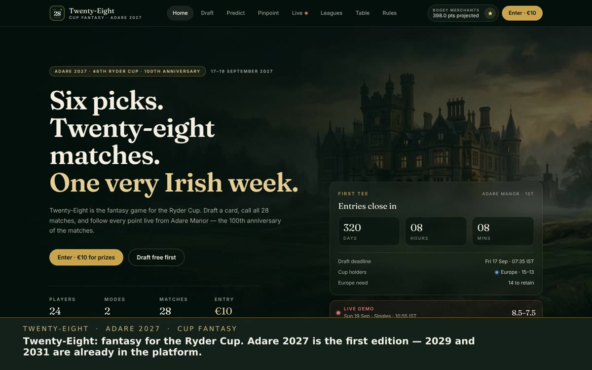

# Demo film

| File | Length | What it shows |
| --- | --- | --- |
| [`twenty-eight-start-to-finish.webm`](twenty-eight-start-to-finish.webm) | 2:48 | **The whole product, in one sitting, nothing faked.** A player buys a €10 entry, drafts a Captain's Dozen card from a €200m budget, calls all 28 matches, makes their Pinpoint guesses, reads their own points breakdown and the global table, creates a private league, watches Sunday singles finish the cup, and an operator settles that league's prize pot from the admin console |

1440×900, VP9 video with burned-in captions, no audio. It plays in every current browser — drag the
file into a tab, or `open twenty-eight-start-to-finish.webm`. To convert for WhatsApp or social:

```bash
ffmpeg -i twenty-eight-start-to-finish.webm -c:v libx264 -crf 22 -pix_fmt yuv420p \
  -movflags +faststart twenty-eight-start-to-finish.mp4
```



## What happens, minute by minute

| Time | Step |
| --- | --- |
| 0:00 | Landing page: the Adare 2027 hero, the countdown, the live demo ticker |
| 0:11 | Entry: the three paid plans (€10 / €60 / €24) and the details the receipt carries |
| 0:23 | Checkout opens a **pending order** — no entry exists yet, the app hands back a payment URL |
| 0:29 | Payment settles the order; the entry reference appears and the header flips to **My card** |
| 0:36 | Draft: Captain's Dozen, auto-pick fills a legal card, saved to the server |
| 0:53 | Match predictor: 28 matches plus three awards, saved and locked at the first tee |
| 1:08 | Pinpoint: nearest-the-pin and longest-drive guesses for each day |
| 1:20 | Account: receipt, then card points + prediction points, player by player |
| 1:27 | The table: server-scored global standings with card and predictor points split out |
| 1:34 | Leagues: create a private league, get a join code, see its own table |
| 1:47 | Live: Sunday singles at 4×, the cup decided, the fantasy points following it |
| 2:11 | Operator console: orders, the ledger (5% fees, 95% pool, payouts), prize settlement per pot, result corrections |
| 2:42 | Close: one brand, a new edition every two years |

## How it was made

```
demo/record-tour.mjs
  Puppeteer drives the real app (a clean database, demo payment provider)
        │  CDP Page.startScreencast → one JPEG per painted frame
        │  every step's caption written to run/cues.json with its timestamp
        │  a gold ring is drawn around the control about to be used
        ▼
demo/render-tour.mjs  (ffmpeg)
        │  frames → concat list with real gaps → 30 fps CFR
        │  captions → an ASS track burned in over a lower-third bar
        │  libvpx-vp9, CRF 35, yuv420p
        ▼
twenty-eight-start-to-finish.webm
```

Nothing is staged: it is the same build the tests run against, and the stills in [`stills/`](stills)
are frames from this run, one per step (`01-home` … `15-admin-results`).

## Re-recording it

```bash
cd adare-fantasy
npm install && npm run build
rm -rf .data
SESSION_SECRET="$(openssl rand -hex 24)" \
ADMIN_TOKEN="tour-admin-token-7d2e41" \
PAYMENTS_PROVIDER=demo npm start          # terminal 1

cd verification/harness && npm install     # Chromium lives here
cd ../..
ADMIN_TOKEN=tour-admin-token-7d2e41 node demo/record-tour.mjs   # ~3 minutes
FFMPEG=/path/to/ffmpeg node demo/render-tour.mjs                 # ~5 minutes
```

`record-tour.mjs` accepts `BASE` and `OUT`; `render-tour.mjs` accepts `FFMPEG`, `OUT`, `TARGET` and
`FONTS`. `run/` is gitignored — the frames are ~2 GB of JPEGs; only the film is committed.

### Narration

`render-tour.mjs` will mux a narration track when `run/narration.json` exists:

```json
[{ "file": "01.mp3", "start": 2.7 }, { "file": "02.mp3", "start": 36.0 }]
```

Each clip is delayed to its `start` and mixed to one Opus stream, so the film can be re-narrated
without re-recording the screen.
